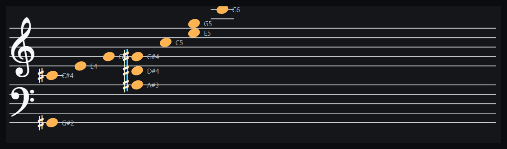

# MIDI 实时五线谱（MidiVisualizer）

接上 MIDI 键盘，把**当前弹奏的音高实时画在大谱表上**，同时把 MIDI 原样**直通**给你的音源（Kontakt 7 等）。
本软件**不发声**——音源由你自己的 Kontakt 7 负责。

- 技术栈：C# / .NET 10 / Avalonia 12（MVVM，CommunityToolkit.Mvvm）
- 平台：Windows（MIDI 走 winmm，无需任何第三方运行库）
- 依赖：无（连 UI 之外的库都只有 Avalonia + MVVM Toolkit）



---

## 功能

### 1. 五线谱显示（核心）

| 行为 | 说明 |
|---|---|
| 高音 / 低音谱号 | **常驻显示**，谱号压在五线上（谱线从左端一直画到右端） |
| 音高位置 | 按全音阶序号精确定位，跨谱表时自动加**加线** |
| 变化音 | 升号 ♯ / 降号 ♭ 画在符头左侧，字号小于符头；可切换「降号优先」 |
| 横向排列 | **先后弹奏的音从左往右依次排列**，相邻两列间隔 3 个谱间距 |
| 柱式和弦 | 只有**几乎同时按下**（默认 70ms 内且前一个音还按着）的音才并进同一列纵向叠起来 |
| 取消显示 | 收到 **note-off 立刻取消该音显示**，不做踏板延音 |
| 重新开始 | 谱面上已经没有可见音符时，下一次弹奏从最左边重新排 |
| 音名标注 | 可选在符头右侧显示 `C#4` 这类音名 |

### 2. 屏幕钢琴 + 和弦识别

- 88 键屏幕钢琴，按下的键高亮并在上方显示音名
- 下方圆角框显示和弦名：根音大字号 + 和弦性质小字号（例：`G sus2(no5)`，与参考视频一致）
- 支持 `no5` / `no3` 省略写法与转位斜杠低音（如 `C/E`）

### 3. MIDI 直通（给 Kontakt 7）

- 输出端口可**多选**，支持通道过滤、±12 半音移调
- 直通是**原样转发**：CC64 延音踏板、弯音、CC1 都会照常送到音源
- 断开连接 / 退出程序时自动发 `All Notes Off` + 踏板复位，避免音源里留下卡住的长音
- 设备热插拔监测（每 2 秒），输入设备掉了会提示

### 4. 音频路由向导

只做**检测和提示**，不参与任何音频处理。会枚举系统音频端点，标出虚拟声卡和 Focusrite 的
Loopback 通道，并给出发送"麦克风 + Kontakt"给对方的具体步骤。

---

## 快速开始

```powershell
# 直接运行（已编译好的）
src\MidiVisualizer.App\bin\Debug\net10.0\MidiVisualizer.exe

# 或从源码运行
dotnet run --project src\MidiVisualizer.App
```

1. **① MIDI 输入** → 选你的键盘（例如 `X6pro`）
   ⚠️ 不要选虚拟回环端口（如 loopMIDI 的端口），否则会自己吃自己形成死循环
2. **② MIDI 直通** → 勾上虚拟 MIDI 端口（loopMIDI 建的），并在 Kontakt 7 里把它设为 MIDI 输入
3. 弹琴 → 五线谱实时显示

### 命令行参数

| 参数 | 用途 |
|---|---|
| `--list-devices` | 打印 MIDI 输入/输出端口与音频端点，排查链路（含虚拟声卡检测） |
| `--selftest` | 跑排版逻辑与和弦识别的自检（不需要 MIDI 设备） |
| `--render-preview <路径>` | 不开窗口，直接把五线谱渲染成 PNG，用于核对排版 |

---

## 音频链路：让对方同时听到「你的麦克风 + Kontakt」

> 前提：本软件已经把键盘 MIDI 直通给了 Kontakt，Kontakt 正在发声。

如果你用的是 **Focusrite 声卡（4i4 等带 Loopback 的型号）**，**不需要虚拟声卡**：

```
麦克风 ──> Analogue 1 ┐
                      ├─> Loopback 1-2 ──> 语音软件麦克风 ──> 对方听到「说话 + 弹琴」
Kontakt ─> Playback ──┘
```

1. 任务栏 **Focusrite Notifier**（`F` 图标）→ 右键 → `Expose/Hide Windows Channels`
   → 勾上 **Loopback L + R**（可再把 `Playback 3-4` 也勾出来，用来单独送出 Kontakt）
2. **Kontakt 7 的音频输出设备选 WDM/WASAPI 的 `Focusrite USB Audio`（或暴露出来的 `Playback 3-4`），不要用 ASIO**
   —— ASIO 的输出不经过 Focusrite Control 的混音器，Loopback 混音里抓不到它
3. **Focusrite Control / Control 2 → 混音器**：给 Loopback 对应的 Mix 只推两路
   - `Analogue 1`（你的麦克风）
   - Kontakt 所在的那一路 `Playback`（推荐单独用 `Playback 3-4`，这样系统提示音不会漏给对方）
4. **语音软件**（QQ / 微信 / Discord…）
   - 麦克风 → `Loopback L + R`
   - 扬声器 → **不要**留在 Kontakt 那一路 Playback 上，否则对方会听到自己的回声
     （推荐：Kontakt 走 `Playback 3-4`，语音软件扬声器留默认 `Playback 1-2`）
5. 关掉语音软件里的「自动增益 / 回声消除 / 降噪」，手动设麦克风音量——这些处理会明显吃掉钢琴音色

官方说明：
[用 Loopback 给 Windows 聊天软件增加多路输入](https://support.focusrite.com/hc/en-gb/articles/11064999655314-Adding-multiple-inputs-in-streaming-software-on-Windows-using-Loopback) ·
[Expose/Hide Windows Channels](https://support.focusrite.com/hc/en-gb/articles/360010711620-Expose-Hide-Windows-Channels-for-non-ASIO-Windows-apps)

**没有 Loopback 的声卡**：装 VB-CABLE 或 VoiceMeeter，把 Kontakt 的输出送进虚拟线缆，
语音软件麦克风选虚拟线缆的录音端；想自己也听到就在「声音 → 录制 → 虚拟线缆 → 属性 → 侦听」里勾选监听。

### MIDI 侧为什么必须装 loopMIDI

Windows 上物理 MIDI 端口是**独占**的：本软件占用了键盘端口，Kontakt/DAW 就打不开它。
所以链路必须是 `键盘 → 本软件 → loopMIDI 虚拟端口 → Kontakt`，loopMIDI 记得设为开机自启。

---

## 项目结构

```
MidiVisualizer.slnx
src/
  MidiVisualizer.Core/            # 无 UI 依赖
    Midi/MidiInputService.cs           # winmm 输入端口枚举与打开
    Midi/MidiOutputService.cs          # winmm 输出端口
    Midi/MidiThruRouter.cs             # 直通：多端口、通道过滤、移调、复位
    Midi/MidiHub.cs                    # 输入 + 直通 + 按键状态中枢
    Music/Pitch.cs                     # MIDI 音号 ↔ 五线谱位置
    Music/ChordDetector.cs             # 和弦识别（含 sus2(no5) 风格）
    Music/LiveStaff.cs                 # 横向排版模型（分列 / 合并和弦 / note-off 移除）
    Diagnostics/AudioEndpointProbe.cs  # 音频端点枚举（仅提示用）
  MidiVisualizer.App/             # Avalonia UI
    Assets/Bravura.otf                 # 乐谱字体（SIL OFL 1.1）+ LICENSE.txt
    Controls/StaffControl.cs           # 五线谱绘制（含谱号外观参数）
    Controls/PianoKeyboardControl.cs   # 屏幕钢琴
    Rendering/MusicGlyphs.cs           # 乐谱字形度量与锚点
    ViewModels/MainViewModel.cs
    Views/MainWindow.axaml
docs/staff-preview.png
```

乐谱字形使用随程序打包的 **Bravura**（`src/MidiVisualizer.App/Assets/Bravura.otf`），
这是 SIL Open Font License 1.1 的雕版比例乐谱字体（许可原文见 `Assets/LICENSE.txt`），
笔画比 Windows 自带的 Segoe UI Symbol 细得多、比例也是标准乐谱比例。

谱号按字形内部锚点定位（实测值，写在 `Rendering/MusicGlyphs.cs`）：

- 高音谱号：螺旋圈心的孔洞重心（墨迹高度的 61.2% 处）对准 G4 线
- 低音谱号：两个圆点的重心（墨迹高度的 29.2% 处）对准 F3 线

大谱表两行之间只有 2 个谱间距（由严格的音高映射决定），所以两个谱号各自往回收了一点，
保证中间留出约 1.1 个谱间距的净空；这几个量都是 `StaffControl.cs` 顶部的常量，可直接调。

---

## 已知限制

- 只做显示与 MIDI 直通，**不含内置音源**（按需求设计）
- 不做踏板延音显示：note-off 即取消（按需求设计）
- Windows 上某些机型 `waveOut` 枚举会整体失效（返回 `MMSYSERR_INVALPARAM`），
  此时界面上只列出录音端点；这不影响 MIDI 与显示功能
- 不显示节奏（符头不带符干），横向间距固定 3 个谱间距
